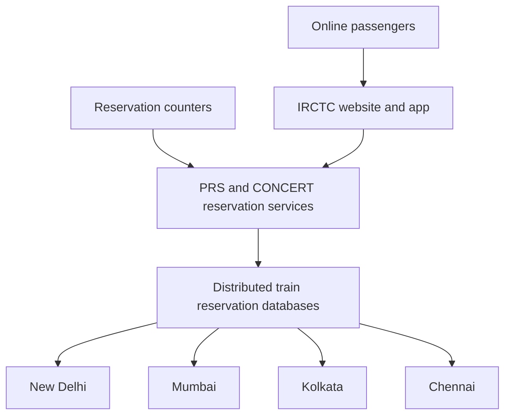
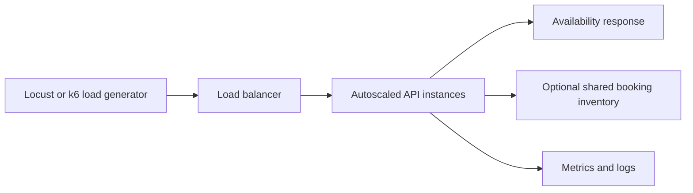

# IRCTC Week 2 case analysis research

**IT457 Cloud Computing | Group 40 | Research checked 24 October 2026**

Week 2 requires a detailed case analysis, architecture diagram, and a 10-page report including an exercise plan and team responsibilities. This research establishes the evidence for that report. Implementation and measured experiment results belong to the later exercise.

## Important correction to Week 1

The Week 1 notes and submission PDF describe Tatkal availability time as increasing by about 65%. The official Ministry of Railways release instead reports that availability time increased **in about 65% of 322 trains**, as of 4 December 2025. It also reports improvement in about 95% of a separate group of 96 popular trains. These percentages describe the proportion of trains, not the size of the time improvement. Use the corrected interpretation in subsequent submissions. The existing Week 1 files have not been rewritten in this research pass. [R2]

## Verified architecture

CRIS describes CONCERT, the nationwide reservation application, as transaction processing over a distributed database with a three-tier client/server architecture. Its PRS project page identifies four data centres: New Delhi, Mumbai, Kolkata, and Chennai. Each hosts databases for trains in the railway zones it serves. This replaces the unverified five-centre description in the earlier research notes. The page is undated, so this is a documented CONCERT architecture, not a verified inventory of the new PRS deployment. [R1]

The following is a conceptual diagram based on that description; arrows represent access relationships, not documented network protocols or replication paths.

The IRCTC access relationship comes from the PIB backgrounder. This diagram does not specify which service runs in which tier. [R3]

## Modernization and capacity

The August 2026 PIB backgrounder identifies the existing generation as Itanium/OpenVMS, deployed in 2010. It describes the replacement as cloud-enabled, records a July 2026 website beta, and lists phased train migration in August 2026. It supports the direction of modernization without disclosing the provider, database engine, container platform, or autoscaling configuration. [R3]

The June 2025 announcement supplies the following baseline and targets. Its December 2025 readiness date was an announced expectation, not evidence of completion. [R4]

| Measure | Published existing capacity | Announced replacement target | Interpretation |
|---|---:|---:|---|
| Bookings per minute | 32,000 | More than 150,000 | Roughly five times the baseline |
| Enquiries per minute | 400,000 | More than 4,000,000 | More than ten times the baseline |

The broader ten-times-load design statement should not be substituted for the separate booking and enquiry ratios. These are capacity claims and targets, not measured latency, observed concurrency, or our experiment results. [R4]

## Demand management and security

Lok Sabha Question 2787, answered on 6 August 2025, confirms that online Tatkal booking was restricted to Aadhaar-authenticated users from 1 July 2025 and agents were barred for the opening 30 minutes. The two-page reply is now read in full. It does not provide the cloud architecture or quantified latency improvements. [R5]

The December 2025 Ministry release confirms deactivation of about 3.02 crore suspicious user IDs, Akamai anti-bot filtering, and protective layers including firewalls, intrusion prevention, application delivery controllers, and web application firewalls. These measures support fair access and security; the release does not isolate the contribution of each measure to the outcome. [R2]

## Case analysis for the report

The workload problem has two parts: concentrated booking demand and automated misuse. Our analysis is that reducing unwanted traffic and expanding useful capacity can complement each other. Authentication and filtering address access and abuse, while modernization addresses processing capacity. Adding servers alone cannot create more seats on a train.

A booking exercise also needs correct seat allocation under simultaneous requests. That is an engineering concern for our design, not a documented diagnosis of a specific IRCTC production database problem. A simple availability API is sufficient for the course infrastructure demonstration; if bookings are added, shared inventory needs atomic updates rather than independent per-instance seat counters.

## Cost and performance evidence still needed

No verified total modernization cost, cloud bill, or net savings is established by the primary material reviewed in this pass. Convenience-fee revenue is income, not infrastructure expenditure, and must not be used as a proxy for operating cost. The earlier Rs 1,000 crore news figure remains unconfirmed.

An IRCTC FY2024–25 annual report was located on NSE, but the browser could not retrieve its full contents because of its size. No new financial figures or observed peak throughput from that report are asserted here. Its internet-ticketing and financial sections are a follow-up task. [R6]

## Proposed exercise for Week 3 planning

This is Group 40's proposed model, not a reconstruction of IRCTC's internal cloud implementation.

Start with a small API exposing availability and health endpoints. Plan a fixed-capacity baseline, a rising-load run with autoscaling, and a falling-load period to observe scale-in. Record average and p95 latency, throughput, errors, active healthy instance count, and scaling timestamps on the same time axis. Estimate cost from resource runtime and published pricing once a provider and region are selected.

A trivial JSON endpoint may not create enough CPU load to trigger a CPU policy. The exercise plan must either use a workload that exercises the chosen metric or choose a supported request-based metric. Document the workload and scaling delays so the conclusions remain reproducible. Rate limiting or a waiting room can be an optional comparison after the required autoscaling demonstration.

## Remaining Week 2 work

1. Retrieve and inspect the annual report for official cost context and historical observed ticketing peaks.
2. Investigate original CRIS/ITI procurement documents for the next-generation PRS. Search results suggest cloud-infrastructure and data-layer tenders, but their original specifications and deployment status are not verified here.
3. Keep unknown new-system components explicitly unknown in the case diagram.
4. Select a provider and region for our exercise, then document resources, scaling policy, load profile, measurements, and estimated experiment cost.
5. Agree responsibilities among Aarya Shah (202301036), Visha Sitapara (202301414), and Krish Dhola (202301189). Do not present suggested roles as already agreed.
6. Develop the 10-page report around background, problem, existing architecture, modernization, outcomes, cost limitations, exercise architecture, experiment plan, responsibilities, and references. This is a proposed structure, not a prescribed page allocation.

## Primary sources and access status

- **R1 — CRIS PRS project page**, undated, directly read: [CONCERT architecture](https://www.cris.org.in/loadpage?page=proPRS). Supports the distributed model and four named centres; not current cloud deployment details.
- **R2 — Ministry of Railways, PIB**, 11 December 2025, directly read: [Reservation security and Tatkal measures](https://www.pib.gov.in/PressReleasePage.aspx?PRID=2202197&lang=2&reg=3). Primary source for correcting the train-percentage statistic.
- **R3 — PIB backgrounder**, 6 August 2026, directly read: [From Queues to Clicks](https://www.pib.gov.in/PressNoteDetails.aspx?NoteId=159450&ModuleId=3&reg=48&lang=1). Supports legacy platform and modernization timeline. PRID 2295409 is a related publication of this backgrounder, not independent corroboration.
- **R4 — Ministry of Railways, PIB**, 29 June 2025, directly read: [New PRS capacity announcement](https://www.pib.gov.in/Pressreleaseshare.aspx?PRID=2140614&lang=2&reg=48). Supports baseline figures and targets.
- **R5 — Lok Sabha USQ 2787**, 6 August 2025, two pages, read in full: [Aadhaar authentication for Tatkal](https://sansad.in/getFile/loksabhaquestions/annex/185/AU2787_Ak5anh.pdf?source=pqals). This working Parliament URL replaces the inaccessible eparlib link for this pass.
- **R6 — IRCTC Annual Report FY2024–25**, located on NSE; full contents not inspected: [Annual report PDF](https://nsearchives.nseindia.com/annual_reports/AR_27340_IRCTC_2024_2025_A_07082025185707.pdf). Follow-up lead only.
