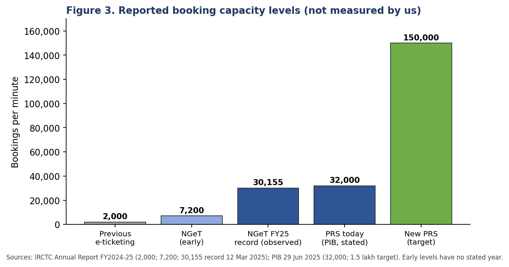
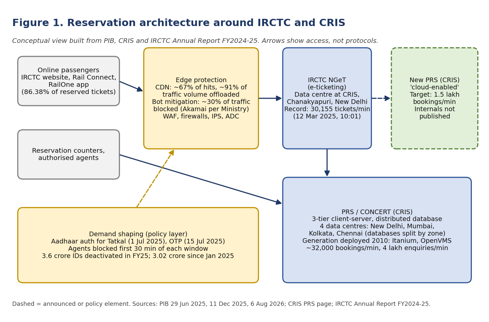
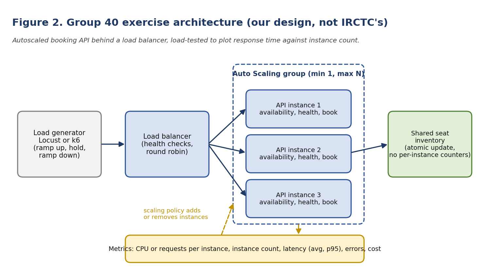

# IRCTC: Cloud Scaling for Railway Ticket Booking and Tatkal Spikes

**IT457 Cloud Computing | Week 2 Report | Group 40**

**Team:** Aarya Shah (202301036), Visha Sitapara (202301414), Krish Dhola (202301189)

**Case theme:** Scalability and High-Traffic Events | **Date:** October 2026

## Abstract

Every morning at 10:00 and 11:00, a large share of India's railway passengers try to book the same Tatkal tickets within seconds. This report studies how IRCTC and the Centre for Railway Information Systems (CRIS) handle that burst. We separate what official sources confirm from what they do not. The evidence shows a two-part response. On the demand side, Indian Railways filters bots and shapes access with a content delivery network, bot mitigation, Aadhaar and OTP checks, and an agent blackout. On the supply side, it is replacing a reservation platform deployed in 2010 with a "cloud-enabled" system targeting more than 1.5 lakh bookings per minute. The new system's internal design, cloud provider and cost are not public, so we do not claim them. We then plan a hands-on exercise: a small booking API behind a load balancer with autoscaling, load-tested with Locust or k6, plotting response time against instance count. The plan, metrics, cost method and team roles are set out in Sections 9 to 11.

## 1. Introduction and scope

Indian Railways runs one of the largest reservation systems in the world. Online booking reaches it through IRCTC's website and apps, while the reservation engine itself, the Passenger Reservation System (PRS), is built and maintained by CRIS [3]. The assigned case asks how this system copes with massive simultaneous demand, especially Tatkal booking.

This report does three things. It analyses the case: the problem, the existing architecture, the solution and the outcomes. It plans the hands-on exercise that comes next. It records each member's responsibilities. Every factual claim carries a source number from the reference list. Where official sources are silent, we say so. The exercise architecture in Section 9 is our own design and is not a description of IRCTC's production system.

## 2. Background: who does what

| Actor | Role in the case |
|---|---|
| CRIS | Designs, builds and maintains the PRS and the NGeT e-ticketing platform for Indian Railways [3][4] |
| PRS / CONCERT | Reservation engine: seats, waitlists, RAC, charts, enquiries. In service since 1986 [3][4] |
| NGeT | Next Generation e-Ticketing system, the online booking front end, launched in 2014 [3][5] |
| IRCTC | Operates the website and apps, books tickets on behalf of Indian Railways and earns convenience fees [5][8] |
| Ministry of Railways | Sets policy such as Aadhaar and OTP rules for Tatkal [1][2][6] |

The scale is large. From June 2025 to June 2026, passengers booked 65.08 crore reserved tickets through the PRS, and 57.90 crore of them (89%) were booked online [3]. IRCTC's own report for FY2024-25 gives an average of 13.88 lakh tickets per day for about 24.41 lakh passengers per day, with 82.58 lakh logins per day. It says its website and apps handled 86.38% of all reserved bookings [5]. The two percentages use different bases (the PRS as a whole versus IRCTC's share), so we quote each with its source.

IRCTC booked 5,065.28 lakh tickets in FY2024-25. Mobile apps carried 2,724.88 lakh of them (about 54%), the website 895.17 lakh (about 18%) and retailers 956.00 lakh (about 19%) [5]. Mobile is therefore the main channel, which matters for how we shape our load test: most requests arrive from phones through an API, not a browser page.

## 3. The problem: a predictable, concentrated burst

Tatkal booking opens at 10:00 for AC classes and 11:00 for non-AC classes [6]. Demand is not spread over the day. It arrives in the first seconds of each window, far above average load, and much of it is automated. PIB states that peak Tatkal periods put pressure on infrastructure "originally designed for a different era" [3].

Three features make this a classic scaling problem:

- **Sharp peak against a low average.** Capacity must be sized for the burst, yet it is idle the rest of the day.
- **Hostile traffic.** Bots multiply requests and take tickets in seconds. IRCTC reports that bot mitigation blocked about 30% of traffic at the edge, and that about 3.6 crore user IDs were flagged as suspicious and deactivated in FY2024-25 [5].
- **A shared, scarce resource.** Extra servers cannot create extra seats. Every booking contends for the same seat inventory, so correctness under concurrency matters as much as raw throughput.

The capacity figures show how far the system has had to move. The previous e-ticketing system handled about 2,000 bookings per minute. NGeT raised that to 7,200 and then to over 30,000 [5]. IRCTC reports a record of 30,155 tickets in one minute on 12 March 2025 at 10:01 [5]. That time sits just after the AC Tatkal opening, though the report does not itself call it a Tatkal peak. NGeT is also reported to support 34.32 lakh concurrent users [5]. PIB gives current PRS capacity as about 32,000 bookings and 4 lakh enquiries per minute [1][3].

### 3.1 How the system evolved

| Year | Event | Source |
|---|---|---|
| 1986 | PRS introduced; CRIS established the same year | [3] |
| 1990s | PRS networked across railway zones through CONCERT | [3][4] |
| 2002 | Internet ticket booking begins | [3] |
| 2010 | Current PRS generation deployed on Itanium servers and OpenVMS | [3] |
| 2014 | NGeT launched for online booking | [3] |
| Feb 2025 | CDN and anti-bot protection deployed on NGeT | [5] |
| 12 Mar 2025 | Record 30,155 tickets in one minute | [5] |
| Jun 2025 | New PRS announced; Aadhaar authentication for online Tatkal from 1 Jul | [1][6] |
| Dec 2025 | Ministry reports OTP results; original new-PRS target date | [1][2] |
| Jul 2026 | New IRCTC website beta | [3] |
| Aug 2026 | Phased migration of trains to the new PRS begins | [3] |

The timeline shows a pattern: capacity was raised in steps (2,000, 7,200, then over 30,000 per minute), and each step was followed by a new demand pattern that exposed the next limit. The 2025 measures changed the traffic itself, not only the servers.

## 4. Existing architecture

The architecture we can document comes from three official sources, summarised in Figure 1.

**Reservation engine.** CRIS describes CONCERT as a mission-critical online transaction processing application on a distributed database model, implemented in a three-tier client-server architecture. It has four data centres, at New Delhi, Mumbai, Kolkata and Chennai. Each hosts the database for trains of the railway zones it serves [4]. The current PRS generation was deployed in 2010 on Itanium servers and the OpenVMS platform [3].

**Online front end.** NGeT is hosted in a state-of-the-art data centre set up at CRIS premises in Chanakyapuri, New Delhi [5]. IRCTC's annual report also lists a sanctioned budget of Rs 221 crore for a disaster-recovery site for NGeT, and names failure of the primary data centre as a business-continuity risk [5]. Booking is available around the clock except for a 35-minute break from 23:45 to 00:20 [5].

**Edge and security.** Since 12 February 2025, NGeT has used an anti-bot solution, a content delivery network (CDN) and other security services. IRCTC reports about 67% of hits and about 91% of traffic volume offloaded by the CDN, and about 30% of traffic blocked by the bot mitigation tool [5]. The Ministry adds that Akamai anti-bot filtering, network firewalls, intrusion prevention, application delivery controllers and web application firewalls are used, with CERT-In audits and monitoring [2]. The December 2025 release also states the system is hosted in a dedicated, access-controlled, ISO 27001 certified data centre [2].

This evidence does **not** show that today's booking path runs on a public cloud. An AWS partner (CloudThat) describes a security engagement for IRCTC using WAF, Shield, GuardDuty and EKS, but it is undated, has no figures and does not describe the booking path [9]. We treat it as context only.

## 5. Solution part A: shape the demand

Because extra capacity cannot fix bot traffic or fairness, the Railways first reduced unwanted demand.

| Measure | Detail | Source |
|---|---|---|
| Edge offload and bot blocking | CDN and anti-bot since 12 Feb 2025 | [5] |
| Aadhaar authentication | Required for online Tatkal from 1 Jul 2025 | [6] |
| OTP verification | Aadhaar-based OTP for Tatkal, phased in; operational in 322 trains online and 211 at counters as of 4 Dec 2025 (press reports give 15 Jul 2025 as the start date) | [2] |
| Agent blackout | Agents barred for the first 30 minutes of each Tatkal window | [6] |
| Account clean-up | About 3.02 crore suspicious IDs deactivated since Jan 2025; over 6,800 e-mail domains blocked in FY25 | [2][5] |
| Advance reservation period | Cut from 120 to 60 days | [3] |

The design lesson is that the cheapest request to serve is one that never reaches the application: a CDN absorbs most hits, the bot filter drops a large fraction, and authentication removes non-genuine users before they touch seat inventory.

## 6. Solution part B: add capacity

CRIS is replacing the 2010 PRS generation. PIB describes the new system as "agile, flexible and scalable", cloud-enabled, and designed to handle ten times the current load [1][3]. The announced capacity targets are over 1.5 lakh bookings per minute (about five times 32,000) and over 40 lakh enquiries per minute (ten times 4 lakh) [1]. The new PRS adds a multilingual interface, seat choice and a fare calendar [1]. IRCTC's redesigned website entered beta in July 2026 and is to integrate with the new PRS. Phased migration of trains began in August 2026, with load testing before the old system is retired [3][7]. The original target of December 2025 therefore slipped by about eight months [1][3].

What is **not** public: the cloud provider, database engine, container platform, scaling policies, and whether the new system uses public cloud, government cloud or CRIS data centres. We keep these as explicit unknowns in Figure 1.

## 7. Outcomes and quality of evidence

| Outcome | Evidence | Strength |
|---|---|---|
| Tatkal confirmed-availability time increased on about 65% of the 322 trains with online OTP, and on about 95% of 96 popular trains | PIB, 11 Dec 2025 [2] | Official. Measures the share of trains that improved, not the size of the improvement |
| Over 3.02 crore suspicious IDs deactivated | PIB [2] | Official |
| Record 30,155 tickets in one minute (12 Mar 2025) | IRCTC Annual Report [5] | Company-reported |
| Early beta: Tatkal bookings completed within 3 minutes up over 5%, within 5 minutes up about 3% | News report, Aug 2026 [7] | Secondary |
| 1.5 lakh bookings per minute | PIB target [1][3] | Target only; not yet demonstrated at Tatkal peak |

Two cautions apply. First, a higher capacity target does not add seats, so popular trains can still sell out. Second, we found no independent measurement of latency or error rates during Tatkal, so we cannot say how large the improvement was.

## 8. Analysis: what the case teaches about cloud scaling

The case maps onto standard cloud-scaling ideas. The right-hand column shows how we will reproduce each idea at small scale.

| Concept | In the IRCTC case | In our exercise |
|---|---|---|
| Horizontal scaling and load balancing | The move from 2,000 to over 30,000 bookings per minute and the planned 1.5 lakh target come from adding parallel capacity [1][5] | Several identical API instances behind one load balancer |
| Offloading and caching | CDN absorbs about 67% of hits and 91% of traffic volume [5] | Cache availability responses for a short time and measure the effect (optional) |
| Admission control | Bot blocking (about 30% of traffic), Aadhaar and OTP checks, agent blackout [2][5][6] | Rate limit or waiting queue in front of the API (run R5) |
| Elasticity versus fixed sizing | Tatkal opens at known times, so capacity sized for the peak sits idle most of the day. How IRCTC sizes capacity is not public | Compare reactive autoscaling with scheduled pre-scaling (R3 versus R4) |
| Consistency of shared state | Seat databases are split by railway zone across four data centres [4] | Atomic booking update in one shared store; test that no seat is sold twice (C1) |
| Availability and recovery | Four data centres, a Rs 221 crore disaster-recovery budget for NGeT, a 35-minute nightly break [4][5] | Health checks that remove failed instances; optional second availability zone |
| Cost of peak capacity | Convenience-fee income is public (Rs 954 crore in FY25) but infrastructure cost is not [8] | Cost per run and per 1,000 requests from provider pricing |
| Observability | Ministry cites continuous traffic monitoring by CERT-In and NCIIPC [2] | Latency, errors, instance count and scaling events on one timeline |

Two conclusions follow. First, reducing and filtering demand is as important as adding capacity; the 2025 measures changed outcomes without any new server being described. Second, a burst that arrives at a known time is a good candidate for scheduled scaling, which reactive autoscaling alone cannot match because new instances take minutes to become ready. We will test that second point rather than assume it.

## 9. Exercise plan

**Objective.** Show, with measurements, how a load balancer and autoscaling absorb a Tatkal-style burst, and where they fall short. The brief asks for exactly this: deploy a small web app behind a load balancer with autoscaling, run a load test (Locust or k6), and plot response time against instance count.

**Application.** A small stateless HTTP API with three endpoints: `GET /health`, `GET /availability` for a train, date and class, and `POST /book`. Seats live in a shared store (a database or Redis), never in per-instance memory, so that booking uses an atomic update that cannot sell the same seat twice. A configurable amount of CPU work per request makes the load realistic, because a trivial JSON endpoint may never trigger a CPU-based scaling policy.

| Endpoint | Purpose | Notes |
|---|---|---|
| `GET /health` | Load balancer health check | Returns 200 when the instance can reach the shared store |
| `GET /availability` | Seats left for a train, date and class | Read-heavy; the main load in most runs |
| `POST /book` | Book one seat | Atomic decrement; returns a conflict if sold out |

**Proposed platform (pending group decision).** An Application Load Balancer in front of an Auto Scaling group (minimum 1, maximum 6 small instances) on AWS, scaling on average CPU or requests per target. Alternatives are Azure VM Scale Sets or any host that provides a load balancer, autoscaling and a public URL. The choice must also give the live URL that the course requires.

**Experiments.**

| Run | Setup | Question |
|---|---|---|
| R0 | One fixed instance, ramp load until latency or errors climb | Where does a single instance saturate? |
| R1 | Three fixed instances, same ramp | How does fixed capacity change the knee? |
| R2 | Autoscaling (1 to 6), same ramp | Does latency recover as instances join, and how long does that take? |
| R3 | Tatkal burst: jump from low load to peak in about 10 seconds, hold, then drop | How bad is the lag while new instances start? |
| R4 | Burst with capacity pre-warmed on a schedule | Does scheduling ahead of a known 10:00 spike avoid the lag? |
| R5 (optional) | Burst with rate limiting or a waiting queue in front | Does shaping demand protect latency, as in Section 5? |
| C1 | Correctness: many concurrent bookings for a small number of seats | Is the number sold exactly equal to the number of seats? |

**Load profile (to be tuned in Week 3).**

| Phase | Virtual users | Duration | Purpose |
|---|---|---|---|
| Warm-up | 10 | 2 min | Fill caches, confirm the baseline |
| Ramp | 10 rising to peak in steps | 10 min | Find the knee where latency rises |
| Burst (R3, R4) | Low load jumps to peak in about 10 s | 5 min | Imitate a Tatkal opening |
| Cool-down | Back to 10 | 5 min | Observe scale-in and cost after the peak |

Peak users will be chosen so that one instance clearly saturates, so the effect of extra instances is visible. About 90% of requests will be availability checks and 10% bookings, which is a modelling assumption, not an IRCTC statistic.

**Scaling policy (starting values, not final).**

| Setting | Starting value | Why |
|---|---|---|
| Minimum / maximum instances | 1 / 6 | Keeps cost low while giving a visible range |
| Metric | Average CPU, target 50-60%, or requests per target | Chosen to match the workload |
| Instance warm-up | Provider default, recorded | Launch delay is part of the result |
| Scale-in cooldown | Provider default, recorded | Avoids flapping; affects cost |
| Scheduled action (R4) | Raise minimum capacity a few minutes before the burst | Tests pre-scaling |

**Metrics.** Average, p50, p95 and p99 latency, requests per second, error rate, healthy instance count and scaling timestamps on one time axis, and CPU or request count per instance. Locust writes request statistics to CSV; the provider's monitoring gives instance counts. The main chart is response time against instance count, with a time-series chart of each run beside it.

**Cost method.** Cost is instance-hours multiplied by the hourly price, plus load balancer hours and load-balancer capacity units, plus data transfer. We will read prices from the provider's calculator once the region is fixed, record run durations, and report cost per run and an extrapolated cost per 1,000 requests. We will shut resources down after each session. We have not yet quoted any price figures.

**Acceptance criteria.** The exercise counts as complete when: the app is reachable at a public URL; every run in R0 to R4 and C1 is saved as CSV with its settings; the response-time-versus-instance-count chart and a per-run timeline are produced; the correctness test sells exactly as many seats as exist; and the cost table is filled from the provider calculator.

**Hypotheses to test.** (H1) Latency rises sharply once load exceeds fixed capacity. (H2) Autoscaling restores latency, but only after a launch delay of minutes. (H3) Because Tatkal timing is known, scheduled pre-scaling beats reactive scaling for the burst. These are hypotheses for our app, not claims about IRCTC.

**Risks.** The load generator can become the bottleneck, so we will run it from a separate machine and watch its CPU. Scaling cooldowns and warm-up times can distort results, so we will record the policy settings. Cloud credits are limited, so runs will be short. We will test only our own deployment.

**Timeline.** Week 3: build the app, deploy, run R0 to R5 and C1, collect data. Week 4: charts, cost table and report update. Week 5: viva preparation.

## 10. Team responsibilities

Each member owns the areas below and reviews the others' work. All members commit to the shared GitHub repository regularly, so the commit history shows who did what.

| Member | Responsibilities |
|---|---|
| Aarya Shah (202301036) | Research and source collection; building the booking API application; deployment to the cloud and making the live URL |
| Visha Sitapara (202301414) | Architecture diagrams; exercise design; load tests; correctness test |
| Krish Dhola (202301189) | Research; citations and the reference list; writing and assembling the report sections; progress document |

Status: these responsibilities were discussed and agreed among all three members.

## 11. Limitations and open questions

- The new PRS's architecture, provider and cost are not public. Rs 1,000 crore appears in only one news report and is unconfirmed [10].
- Revenue is not cost. RTI data show IRCTC convenience-fee revenue of Rs 954 crore in FY2025, but that is income, not infrastructure spending [8].
- We found no measured Tatkal latency or error data, so outcome claims rest on the Ministry's train counts and company-reported records.
- Our exercise is a scaled-down model. Its results will show scaling behaviour, not IRCTC's real numbers.

## Appendix A. Evidence register and correction

| Claim | Status | Note |
|---|---|---|
| 32,000 bookings and 4 lakh enquiries per minute today | Verified | PIB [1][3] |
| 1.5 lakh bookings and 40 lakh enquiries per minute target | Verified as a target | Not yet demonstrated |
| 30,155 tickets in a minute, 12 Mar 2025 | Verified | IRCTC Annual Report [5] |
| Availability time rose 65% on 322 trains | **Corrected** | PIB says it increased on about 65% of the 322 trains. Earlier drafts and news summaries misread this as a 65% rise in time [2] |
| New PRS runs on AWS | Not supported | No official source names a provider |
| Rs 1,000 crore programme cost | Unconfirmed | One news report only [10] |
| Core PRS databases at four data centres | Verified for CONCERT | CRIS page is undated; not proof for the new PRS [4] |

## Appendix B. Glossary

- **PRS:** Passenger Reservation System, the reservation engine run by CRIS.
- **CONCERT:** Country-wide Network for Computerised Enhanced Reservation and Ticketing, the nationwide PRS application.
- **NGeT:** Next Generation e-Ticketing, IRCTC online booking platform.
- **Tatkal:** Short-notice booking quota that opens at 10:00 (AC) and 11:00 (non-AC).
- **Autoscaling:** Adding or removing instances automatically from a metric or a schedule.
- **p95 latency:** The response time that 95% of requests beat.
- **CDN:** Content delivery network that serves repeated requests from servers near users.

## References

1. Ministry of Railways, PIB. "New Passenger Reservation System capable of generating over 1.5 lakh rail tickets per minute", 29 Jun 2025. https://www.pib.gov.in/PressReleseDetailm.aspx?PRID=2140614&reg=3&lang=2
2. Ministry of Railways, PIB. "Indian Railways strengthens ticket reservation system with robust cyber security", 11 Dec 2025 (PRID 2202197). https://www.pib.gov.in/PressReleasePage.aspx?PRID=2202197&lang=2&reg=3
3. Ministry of Railways, PIB. "Four Decades of Passenger Reservation in Indian Railways", 6 Aug 2026. https://www.pib.gov.in/PressNoteDetails.aspx?NoteId=159450&ModuleId=3&reg=48&lang=1
4. Centre for Railway Information Systems. PRS project page (CONCERT, NGeT). https://www.cris.org.in/loadpage?page=proPRS
5. IRCTC. Annual Report 2024-25 (pp. 66, 104-105 and risk section). https://nsearchives.nseindia.com/annual_reports/AR_27340_IRCTC_2024_2025_A_07082025185707.pdf
6. Lok Sabha Unstarred Question 2787, answered 6 Aug 2025 (Aadhaar authentication for Tatkal). https://sansad.in/getFile/loksabhaquestions/annex/185/AU2787_Ak5anh.pdf?source=pqals
7. Business Today. "Indian Railways' new ticket booking system will be 5x faster", 11 Aug 2026. https://www.businesstoday.in/latest/trends/photo/indian-railways-new-ticket-booking-system-will-be-5x-faster-heres-whats-changing-for-irctc-users-548374-2026-08-11
8. Punekar News. "IRCTC website revamp announced after RTI exposes Rs 2,619 crore convenience fee earnings", 17 Jun 2026. https://www.punekarnews.in/irctc-website-revamp-announced-after-rti-exposes-rs-2619-crore-convenience-fee-earnings/
9. CloudThat. "Strengthening defenses against common web exploits and malicious IPs with AWS security services for IRCTC" (undated). https://www.cloudthat.com/resources/case-study/strengthening-defenses-against-common-web-exploits-and-malicious-ips-with-aws-security-services-for-irctc
10. Zee News. "Indian Railways spends Rs 1,000 cr to revamp 40-year-old IRCTC reservation system", 16 Mar 2026 (cost figure not corroborated).
