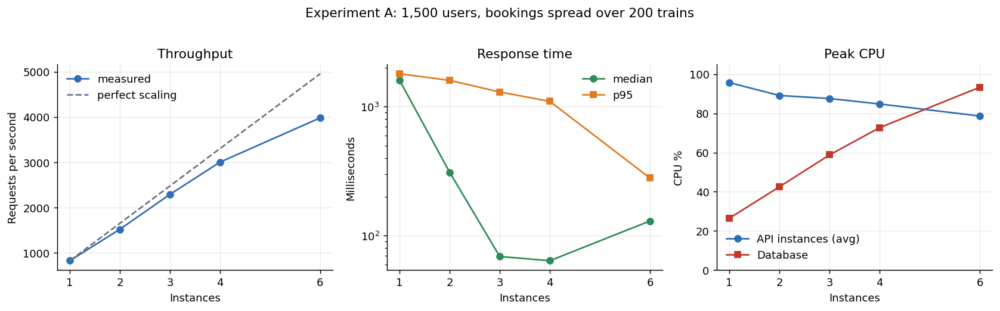
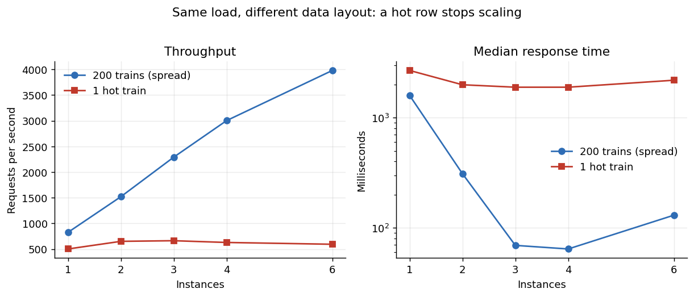
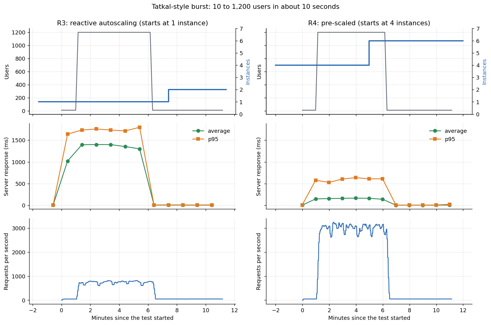

# Week 3: AWS deployment and experiments

This section extends `implementation_and_testing.md` (local phase) with the cloud
phase: the same Dockerised booking API deployed behind a load balancer with
autoscaling, load-tested from inside the same AWS region.

All numbers come from our own deployment and a synthetic workload. They are not
IRCTC figures and should not be read as a model of IRCTC's real capacity.

## 1. What was deployed

| Part | Setting |
|---|---|
| Region | ap-south-1 (Mumbai), default VPC, three availability zones |
| Load balancer | Application Load Balancer, HTTP :80, health check `/health` every 15 s |
| Compute | Auto Scaling group, minimum 1 and maximum 6, `t3.small` (2 vCPU, burstable), Amazon Linux 2023 |
| Scaling rule | Target tracking on average CPU, target 50% |
| Application | the Week 3 Docker image from ECR, 2 uvicorn workers per instance, connection pool of 8 per worker |
| Database | Amazon RDS PostgreSQL 17, `db.t3.medium`, single AZ, not public |
| Load generator | `c6i.xlarge` in the same region, Locust with 4 processes |
| Network rules | internet to load balancer :80, load balancer to API :8000, API to database :5432 |

Changes made to the application for the cloud phase: a database connection pool,
a configurable worker count, an advisory lock so that several workers or
instances can start at the same time without racing on table creation, and a
75-second keep-alive (see finding 5).

Everything is created and removed by the scripts in `week3/aws/`.

## 2. Workload and method

- **Mix:** half availability checks and half booking requests, with 0.1 to 0.3 s of
  think time. This is deliberately booking-heavy to resemble a Tatkal window. The
  ratio is a modelling choice, not an IRCTC statistic.
- **Experiments A and B (fixed capacity):** 1,500 simulated users for 3 minutes at
  exactly 1, 2, 3, 4 and 6 instances, with autoscaling switched off. Data was reset
  before each run. The only difference between A and B is where bookings go.
  - **A, spread:** bookings go to 200 different trains.
  - **B, hot train:** every booking goes to one train.
- **Burst (R3 and R4):** 10 users for 60 s, a jump to 1,200 users in about 10 s,
  held for 5 minutes, then back to 10 users. Bookings spread over 200 trains.
  - **R3, reactive:** starts at 1 instance and relies on the CPU scaling rule.
  - **R4, pre-scaled:** starts at 4 instances (capacity added before the window).
- **Correctness:** `201` (booked) and `409` (sold out) both count as valid answers.
  Any other status counts as a failure.
- **One run per setting.** We did not repeat runs, so small differences (for
  example between 3 and 4 instances at the median) are within noise.

## 3. Results

### 3.1 Experiment A: response time against instance count



| Instances | Requests/s | Median | p95 | p99 | API CPU (peak) | Database CPU (peak) | Failed requests |
|---|---|---|---|---|---|---|---|
| 1 | 826 | 1,600 ms | 1,800 ms | 2,000 ms | 96% | 26% | 8 of 148,731 |
| 2 | 1,521 | 310 ms | 1,600 ms | 3,100 ms | 89% | 43% | 10 of 273,879 |
| 3 | 2,291 | 69 ms | 1,300 ms | 1,900 ms | 88% | 59% | 17 of 412,653 |
| 4 | 3,004 | 64 ms | 1,100 ms | 1,400 ms | 85% | 73% | 22 of 541,140 |
| 6 | 3,981 | 130 ms | 280 ms | 520 ms | 79% | 93% | 7 of 717,680 |

- Throughput grows almost in a straight line, about 830 requests per second for
  each `t3.small` instance.
- The median falls from 1.6 s to under 100 ms between one and three instances. The
  tail (p95) improves more slowly and only drops sharply at six instances.
- At six instances the database CPU is 93%, so the next scaling limit is the data
  tier. The median going up from 64 ms to 130 ms between four and six instances
  is consistent with that, but we did not measure it directly.
- The failed requests we inspected (the runs at 1, 2 and 4 instances) were all
  `502` responses from the load balancer (see finding 5); we did not inspect the
  other two runs. The fix was applied after this experiment, and R3 and R4 had no
  failures.

### 3.2 Experiment B: one hot train



| Instances | Requests/s | Median | p95 | API CPU (peak) | Database CPU (peak) |
|---|---|---|---|---|---|
| 1 | 502 | 2,700 ms | 3,200 ms | 67% | 25% |
| 2 | 651 | 2,000 ms | 3,100 ms | 46% | 36% |
| 3 | 663 | 1,900 ms | 4,400 ms | 32% | 43% |
| 4 | 629 | 1,900 ms | 4,400 ms | 24% | 48% |
| 6 | 594 | 2,200 ms | 4,000 ms | 16% | 62% |

Adding instances did not raise throughput or lower latency. The API servers sat
mostly idle (CPU falling from 67% to 16%) and the database was not saturated.
Bookings stayed at roughly 250 to 330 per second in every run.

Our explanation is that every booking updates the same inventory row, and the
database lets only one transaction hold that row's lock at a time, so bookings
queue behind each other. This matches what we measured (idle servers, idle
database, flat throughput, and a clean contrast with Experiment A), but we did not
read lock-wait statistics from the database, so it remains an inference.

This is the realistic Tatkal case: demand concentrates on a few popular trains.
Scaling the application tier does not remove a bottleneck in the data tier.

### 3.3 Tatkal-style burst: reactive against pre-scaled



| | R3 reactive (1 instance at start) | R4 pre-scaled (4 instances at start) |
|---|---|---|
| Requests | 253,875 | 961,193 |
| Median / p95 / p99 | 1,400 / 1,700 / 2,700 ms | 74 / 630 / 830 ms |
| Failed requests | 0 | 0 |
| Throughput during the burst | about 800 requests/s | about 3,000 requests/s |
| Scaling that happened | 1 to 2 instances, in service about 6.4 min after the burst began | 4 to 6 instances, in service about 4 min after the burst began |

The burst itself lasted about 5.2 minutes. In R3 the autoscaler's new instance
became active after the burst was already over, and it was only one instance. The
reactive group therefore served the whole peak at the capacity of a single
instance. We have not established why the first scale-out took this long (metric
and alarm delay, and instance start-up time of roughly 70 to 80 s, are likely
contributors). We report the observation, not a cause.

### 3.4 Cost

Prices are Mumbai on-demand, read from the AWS price list on the day of the runs:
`t3.small` $0.0224/h, `db.t3.medium` $0.106/h, `c6i.xlarge` $0.17/h. The load
balancer figure of about $0.024/h is approximate (the price-list query returned a
network load balancer entry, so it was not confirmed for an application load
balancer) and excludes its usage-based charge.

Cost to serve the steady load of Experiment A (API instances, database and load
balancer only; the load generator is test equipment and is excluded):

| Instances | Cost per hour | Requests/s | Cost per million requests |
|---|---|---|---|
| 1 | $0.152 | 826 | $0.051 |
| 2 | $0.175 | 1,521 | $0.032 |
| 3 | $0.197 | 2,291 | $0.024 |
| 4 | $0.220 | 3,003 | $0.020 |
| 6 | $0.264 | 3,981 | $0.018 |

Cost per request falls as instances are added, because the database and load
balancer are fixed costs shared by more traffic. In the burst, R4 ran about three
more instances than R3 for about 12 minutes, an extra cost of roughly 1 to 2
cents, for about 19 times lower median latency.

The whole session (about 2.8 hours with the database, load balancer, up to six
API instances and the load generator) cost an estimated **$1 to $1.50**. This
excludes small items we did not measure (load balancer usage charges, burst-credit
charges on `t3` instances, S3 and data transfer).

### 3.5 Follow-up experiments

These runs were collected in a second AWS session on 12 November 2026. They
extend the fixed-capacity and initial burst experiments above. Each setting was
run once; comparisons are observations, not statistically significant estimates.

**Concurrent correctness (C1).** The correctness suite passed **29/29 checks**
with one instance and **29/29** with three instances. The checks cover concurrent
bookings through the AWS deployment. Database verification files for the
follow-up ramp, scheduled burst, shedding and failure runs report zero inventory
consistency violations.

**Ramp (R0–R2).** The same 10-to-1,500-user ramp was run with one fixed instance,
three fixed instances, and autoscaling from one to six. All three Locust runs
recorded zero failed requests.

| Run | Capacity | Requests | Requests/s | Median | p95 | p99 | Peak API CPU | Peak DB CPU |
|---|---|---:|---:|---:|---:|---:|---:|---:|
| R0 | 1 fixed | 424,767 | 416 | 840 ms | 2,000 ms | 2,300 ms | 100% | 27% |
| R1 | 3 fixed | 871,184 | 853 | 91 ms | 1,600 ms | 2,100 ms | 81% | 49% |
| R2 | autoscaling, peak 6 | 565,873 | 554 | 380 ms | 1,800 ms | 2,200 ms | 100% | 39% |

R1 handled more traffic with lower median latency than R0. R2 reached six
instances but did not outperform R1 in this single run. The experiment does not
establish why; autoscaling activity and run-to-run variation are possible factors.
See [the ramp chart](figures/fig_d_ramp.png).

**Scheduled pre-scaling.** A scheduled action was used to add capacity ahead of
the burst. The run recorded 719,752 requests, 1,074 requests/s, median latency
66 ms (p95 1,300 ms, p99 1,600 ms), zero Locust failures, and a peak of six
instances. Database CPU peaked at 59%. The saved schedule record gives the
scheduled action start as `2026-11-12T08:53:00Z`. This is a separate run from the
manual pre-scaling result above; their totals should not be compared as if they
were repetitions under identical timing.

**Load shedding (R5).** The run was configured with an admission limit of 32
in-flight requests per worker, but Locust recorded **zero 429 responses**. It
therefore did not demonstrate that load shedding protects served-request
latency. The run served 234,674 requests; the comparable reactive run served
253,875. Median and p95 latency for `/availability` were 1,400/1,800 ms with the
configured limit, versus 1,300/1,700 ms for the reactive run. For `/book` they
were 1,500/1,900 ms versus 1,400/1,700 ms. These measurements do not support a
latency benefit from the configured run. The admission-control mechanism or its
deployment needs investigation before drawing a conclusion. See
[the shedding chart](figures/fig_e_shed.png) and
[the combined burst chart](figures/fig_g_burst_all.png).

**Instance failure.** During a steady-load run, instance `i-01eabdec722d3f55f`
was terminated at `2026-11-12T09:15:22Z`. Locust recorded 501,206 requests,
1,392 requests/s, and 5,964 failures. The failures occurred over a 41-second
window, from 2.27 to 2.95 minutes after the run began; the instance termination
was at 1.98 minutes. CloudWatch metrics recorded 5,964 load-balancer 5xx and
zero target 5xx, with a minimum of two instances in service. Database
verification found zero consistency violations. This shows a brief availability
impact during instance replacement while booking consistency was maintained;
the available measurements do not identify the exact load-balancer failure
mechanism. See [the failure chart](figures/fig_f_failure.png).

The machine-readable figures and aggregates are in
[`summary_extra.json`](figures/summary_extra.json). The charts were generated
from the saved Locust CSV files and CloudWatch metric snapshots.

## 4. Findings

1. **The application tier scales almost linearly** while the data is spread out,
   at about 830 requests/s per `t3.small` with two workers.
2. **A hot inventory row caps throughput** regardless of server count. Scaling
   servers cannot fix this; the design of the data tier has to change.
3. **The database becomes the next limit** at about six instances (93% CPU).
4. **Reactive autoscaling was too slow for a sudden spike.** Pre-scaling before the
   window gave far better latency for a few cents.
5. **Keep-alive mismatch between the load balancer and the server.** The load
   balancer keeps idle connections for 60 s while uvicorn closed them after 5 s,
   which produced rare `502` errors (at most 22 in 541,140 requests). Setting the
   server keep-alive to 75 s removed them in the burst runs.
6. **The fixed-capacity ramp improved when moving from one to three instances,**
   but the single autoscaled run did not exceed the three-instance result. This
   warrants repeated runs before making a scaling-policy claim.
7. **Scheduled capacity reached the burst ahead of demand,** with 66 ms median
   latency and no Locust failures in that run.
8. **The load-shedding experiment was inconclusive.** No 429 responses were
   recorded, so the intended admission control was not observed under load.
9. **Terminating an instance caused a short 5xx window** in the failure test,
   even though the database remained consistent. Availability during replacement
   needs further investigation.

## 5. Limitations

- One run per setting; no confidence intervals.
- The number of workers (2 per instance) and the pool size (8 per worker) were
  chosen, not tuned. We did not compare other values, so we make no claim about
  one worker against two.
- The workload, the 50/50 mix, the think time and the 200-train spread are our
  assumptions.
- Load comes from inside the same region, so network delay is lower than for real
  users across India.
- Single-AZ database and no read replica; a production system would not do this.
- `t3` instances are burstable; the runs used the default unlimited mode.
- Follow-up runs (R0–R5 and C1) were run once per setting. In particular, R5
  produced no shed responses, and the instance-failure run had a short 5xx window;
  neither result should be generalized beyond the observed run.
- The first, light run (100 users from a laptop, 63 requests/s, median 29 ms, no
  failures, instance CPU about 8%) only showed that one instance was far from
  saturated at that load.

## 6. Reproducing

```
bash week3/aws/01-infra.sh        # ECR, security groups, role, database
bash week3/aws/02-image.sh        # build and push the image
bash week3/aws/03-app.sh          # load balancer and Auto Scaling group
bash week3/aws/04-loadgen.sh      # load generator and results bucket
LOCUST_BOOK_TRAIN_COUNT=200 SWEEP_TAG=spread bash week3/aws/sweep.sh "1 2 3 4 6" 1500 180s
bash week3/aws/sweep.sh "1 2 3 4 6" 1500 180s          # hot train (tag: sweep)
bash week3/aws/burst-experiment.sh                      # R3 and R4
python week3/analysis/collect_metrics.py
python week3/analysis/make_charts.py
python week3/analysis/make_charts_extra.py
bash week3/aws/teardown.sh --all                        # remove everything
```

Raw results (CSV files and logs) are in `week3/load_tests/results/aws/`.

## 7. Live AWS resource check and teardown

On **14 November 2026**, the AWS CLI (`aws-cli/2.39.3`) was installed and
authenticated in the terminal. The initial read-only check in `ap-south-1`
found the following resources active:

| Resource | Observed state |
|---|---|
| Auto Scaling group `irctc-asg` | Min 1, max 6, desired 1; one healthy instance in service |
| API instance | One `t3.small`, running |
| Load generator | One `c6i.xlarge`, running |
| RDS `irctc-db` | Available, `db.t3.medium` |
| Load balancer `irctc-alb` | Active |
| Results bucket `irctc-results-…` | Present |

Before teardown, these resources cost about **$0.32 per hour ($7.70 per day)**
using the approximate hourly prices above, before load-balancer usage charges,
data transfer, storage and other metered usage.

The project resources were then shut down. The API and load-generator instances
were terminated; the Auto Scaling group, load balancer, target group, launch
template, RDS instance, ECR repository, project security groups, subnet group,
IAM role and instance profile were deleted. The project CloudWatch alarm query
returned no alarms. Final checks found no project EC2 instances, ASG, RDS
instance, ALB, or ECR repository.

To preserve data, a final manual RDS snapshot,
`irctc-db-final-20261114`, was created and verified **available (100%)** before
the database instance was deleted. The S3 bucket `irctc-results-888348805474`
was kept with the experiment artifacts. These retained storage resources may
still incur storage charges; no running project compute or database remains.

The load-shedding result still needs a corrected rerun before that experiment
can be considered complete.
